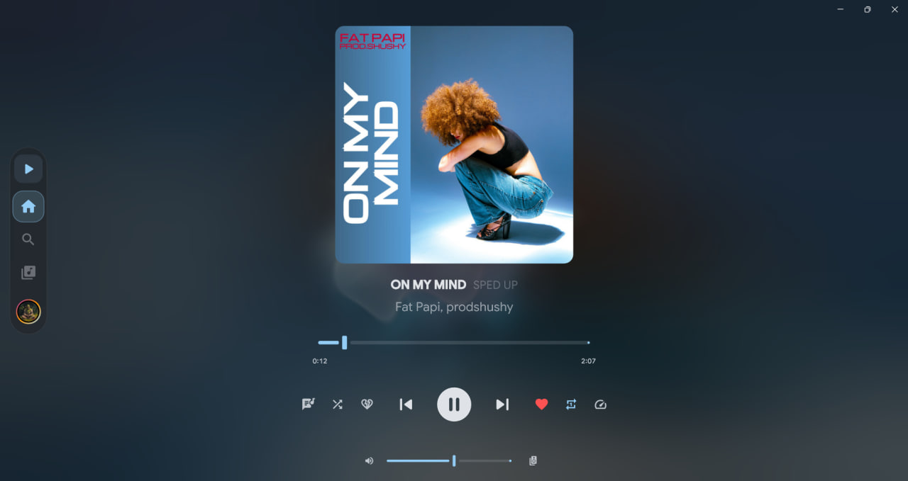
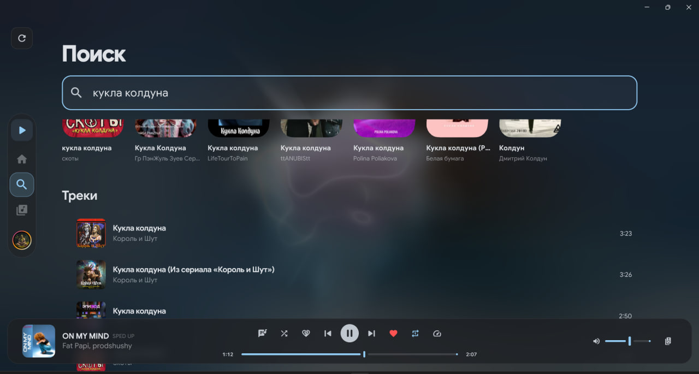
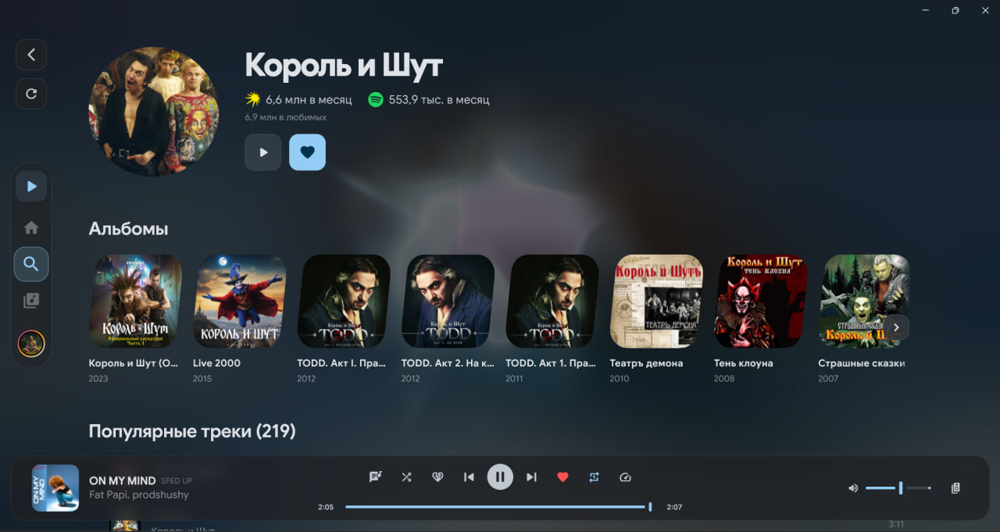

#  SOYAM

Альтернативный клиент Яндекс Музыки на Flutter и Rust. Основная проверенная сборка — Windows x64.

<table>
  <tr>
    <td align="center"></td>
    <td align="center"></td>
    <td align="center"></td>
  </tr>
</table>

## Предупреждение

**SOYAM** — форк [YAYMA](https://github.com/DarkPlayOff/YAYMA). Приложение основано на [YaMusic](https://github.com/yamusic/yamusic) и использует неофициальное API, не предназначенное для публичного использования. Проект находится в стадии активной разработки. Пользуйтесь на свой страх и риск. Проект написан с помощью ИИ.

## Возможности

- **Воспроизведение**: Моя волна, поиск, библиотека, альбомы, плейлисты, скачивание треков и выбор качества звука.
- **Рекомендации**: настройка «Меньше ИИ» синхронизируется с аккаунтом Яндекс Музыки.
- **Исполнители**: отдельные счётчики слушателей Яндекс Музыки и Spotify. При недоступности сервиса отображается прочерк.
- **Приватность**: никакой аналитики и слежки со стороны клиента
- **Тексты песен**: Яндекс Музыка, LRCLIB, Lyrics.ovh и Genius; выбор включённых источников прямо в панели текста. Тексты с таймкодами следуют воспроизведению и перемотке, обычные прокручиваются вручную. BetterLyrics и YouLyPlus доступны как дополнительные источники в настройках.
- **Интеграция с системой**: управление из панели задач Windows, глобальные горячие клавиши

## Установка

Скачайте установщик последней версии для Windows и запустите его.
Портативная версия доступна на [странице релизов](https://github.com/wlaster/SOYAM/releases/latest).

## Благодарности ❤️

- [DarkPlayOff](https://github.com/DarkPlayOff/YAYMA) — исходный проект YAYMA

- [Vyfor](https://github.com/vyfor) — за исходный TUI-клиент [YaMusic](https://github.com/yamusic/yamusic) и библиотеку [yandex-music-rs](https://github.com/vyfor/yandex-music-rs) для работы с API Яндекса
- [LrcLib](https://lrclib.net), [BetterLyrics](https://github.com/better-lyrics/better-lyrics), [YouLyPlus](https://github.com/ibratabian17/YouLyPlus) — за базы текстов песен
- [Lyrics.ovh](https://lyrics.ovh) и [Genius](https://genius.com) — источники обычных текстов

## Локальная сборка Windows и проверка текстов

См. [инструкцию](docs/windows-build.md). Полная сборка: `powershell -File scripts/Build-Windows.ps1`. Упаковка готовой Release-сборки с библиотеками MSVC x64: `powershell -File scripts/Package-Windows.ps1`. Скрипт проверяет SHA-256 каждого файла внутри ZIP и создаёт файл `.zip.sha256`. Проверить доступность источников с вашего подключения можно командой `powershell -File scripts/Test-LyricsSources.ps1`.

Собрать установщик из готовой Release-сборки: `powershell -File scripts/Build-Installer.ps1`. Требуется Inno Setup 6 и библиотека MSVC x64 из Visual Studio Build Tools. Скрипт проверяет совпадение версии EXE с `pubspec.yaml` и создаёт установщик с файлом SHA-256; ZIP при этом не создаётся.

## Лицензия

Проект распространяется под лицензией [GPL-3.0](LICENSE).
